# 🧠 Bosshire AI — Jawaban Lengkap Core Requirements 1 & 2
**Konsep Utama:** *Global Remote Reality Check & Reachout Decision Hub untuk Talenta Indonesia (UK / Aussie / US vs Ngantor SCBD)*

---

## 1. Problem & Product Thinking (Bobot 30% — 6 Poin Wajib Brief)

### 1.1 Target User: *Who are you designing for?*
- **Profil Utama:** Pekerja digital/kreatif *Mid-to-Senior* di Indonesia (seperti *Product Designer*, *Software Engineer*, *PM*) yang tinggal di kota besar (Jakarta/Bandung/Surabaya).
- **Kondisi Nyata:** Sudah lelah menghabiskan **2–3 jam setiap hari (60+ jam/bulan)** macet di jalan atau berdesakan di KRL/TransJakarta menuju kawasan kantor seperti SCBD atau Kuningan.
- **Tujuan & Hambatan:** Mengincar pekerjaan *Global Remote* dari rumah di Indonesia (`WIB / UTC+7`) untuk perusahaan di **Inggris (UK), Australia, US, atau Singapura** (atau baru saja di-*reachout* oleh recruiter luar negeri), tetapi **belum familiar dengan istilah kontrak luar negeri, pajak/potongan, dan simulasi jam kerja lintas zona waktu**.

### 1.2 Problem Statement: *What specific friction point are they experiencing?*
Saat talenta Indonesia melihat lowongan *remote* luar negeri atau menerima pesan *reachout* dari recruiter asing (misalnya dari London, UK), mereka mengalami **4 titik kebingungan utama sebelum berani mengambil keputusan**:
1. **Jebakan "Remote Palsu":** Banyak iklan bertuliskan *"Remote"*, padahal di bagian syarat hukum tertulis wajib berdomisili atau punya izin kerja di negara tersebut (*UK/US residents only*), bukan *bisa kerja dari Indonesia*.
2. **Ketakutan Jam Hidup Terbalik di WIB (`UTC+7`):** Kandidat sulit membayangkan apakah kerja dengan tim Inggris (`UTC+0`) atau US berarti harus begadang tiap malam, atau cukup *online* bareng (*overlap*) 3 jam di sore hari WIB.
3. **Ilusi Gaji Valuta Asing vs Gaji SCBD:** Tawaran `£3,200/bln` atau `AUD $5,500/bln` terlihat besar, tapi kandidat bingung menghitung **nilai bersih Rupiah** (setelah potong biaya transfer bank, asuransi mandiri, tanpa THR) dibandingkan gaji kantor SCBD (dikurangi ongkos transport & waktu macet).
4. **Istilah Kontrak Asing & Informasi Abu-Abu:** Pesan awal recruiter luar sering kali tidak mencantumkan batas jam *meeting* malam atau cara pembayaran gaji ke rekening Indonesia, ditambah banyaknya istilah asing yang tidak dipahami kandidat lokal.

### 1.3 Importance & Opportunity: *Why is this problem worth solving now?*
- **Mengapa Sekarang (Why Now):** Pasca-pandemi dan makin beratnya biaya serta waktu komuter di Jakarta, semakin banyak perusahaan UK, Australia, dan US yang merekrut talenta Indonesia secara *remote* karena kualitas karya yang kompetitif dan zona waktu `WIB (UTC+7)` yang strategis (bisa *overlap* pagi dengan Australia, atau sore dengan Inggris/Eropa).
- **Kegagalan Portal Kerja Lama:** Job portal biasa hanya menyediakan filter statis `"Remote"`. Mereka tidak mampu menerjemahkan arti sebuah lowongan London/Sydney ke dalam **konteks hidup sehari-hari dan hitungan dompet orang di Jakarta**.
- **Peluang bagi Bosshire:** Menjadi platform pertama yang berperan sebagai **"Penerjemah & Pemandu Keputusan Kerja Lintas Negara"**, sehingga kandidat hanya melamar/membalas peluang yang benar-benar layak dan sehat bagi hidup mereka.

### 1.4 Proposed Solution: *How does your concept solve this problem?*
**Bosshire "Global Remote Reality Check & Reachout Hub"** (Gabungan Opsi 1 + Opsi 2, **bukan sekadar chatbot**):
1. **Kamus Kontrak Tanpa Jargon:** AI otomatis menerjemahkan syarat kontrak luar negeri menjadi penjelasan 1 kalimat yang ramah orang Indonesia (*"Bisa kerja dari Jakarta, gaji ditransfer utuh ke BCA/Mandiri, tidak perlu visa Inggris"*).
2. **Visualisasi Jadwal Harian WIB (`WIB Overlap Timeline Chart`):** Mengubah zona waktu perusahaan asing menjadi grafik jadwal harian di Jakarta (kapan jam kerja fokus sendiri vs kapan jam wajib *online* bareng tim luar).
3. **Kalkulator Adu Untung "Remote Luar vs Ngantor SCBD":** Grafik perbandingan gaji bersih Rupiah di rumah vs gaji SCBD, lengkap dengan hitungan **penghematan 60 jam macet/bulan**.
4. **Smart Pre-Reply Clarifier:** Membantu menyusun balasan profesional ke recruiter luar (seperti recruiter British) yang sekaligus menanyakan hal-hal penting yang belum jelas di awal.

### 1.5 Key Assumptions & Prioritization: *What assumptions are you making? What did you prioritize and why?*
- **Asumsi Utama:** Hambatan terbesar talenta *mid-senior* Indonesia saat melamar kerja remote luar negeri bukanlah kurangnya skill teknis, melainkan **keraguan atas kelayakan domisili Indonesia, ketakutan jam kerja malam, dan kebingungan istilah kontrak/gaji bersih**.
- **Apa yang Diprioritaskan:** Kami memprioritaskan **Fase Evaluasi & Kalibrasi Keputusan (Sebelum Apply / Sebelum Balas Recruiter)**.
- **Mengapa Diprioritaskan:** Mencegah user buang waktu di lowongan *"Remote Palsu"* atau terjebak kontrak dengan jam kerja yang merusak kesehatan jauh lebih bernilai daripada sekadar mempercepat tombol *1-Click Apply*.

### 1.6 Scope Trade-offs: *What did you intentionally leave out to keep the solution focused?*
- **✕ Tidak Membuat Chatbot Tanya-Jawab Bebas:** Sesuai aturan utama brief (*"Do not simply build a chatbot"*), seluruh interaksi AI diwujudkan melalui komponen visual terstruktur (Chart WIB, Kartu Sinyal, Pill Kalibrasi, dan Kartu Ketidakpastian).
- **✕ Tidak Membuat Auto-Apply Massal / Pembuat CV dari Nol:** Fokus produk adalah *kualitas keputusan* pada peluang terpilih, bukan mengirim ratusan lamaran otomatis.
- **✕ Tidak Mengurus Pajak/Kontrak Hukum Resmi di Dalam Aplikasi:** Aplikasi cukup memberikan estimasi bersih dan penjelasan bahasa manusia sebagai panduan keputusan.

---

## 2. AI & Human Collaboration (Bobot 25% — 4 Poin Wajib Brief)

```mermaid
flowchart LR
  subgraph Inputs["📥 2.2 Inputs (Data yang Dibaca AI)"]
    I1["Teks Lowongan / Pesan Reachout Recruiter UK"]
    I2["Zona Waktu & Riwayat Hiring Perusahaan"]
    I3["Profil User (Jakarta WIB, Gaji & Ongkos SCBD)"]
  end

  subgraph AIRole["✨ 2.1 & 2.2 Peran & Output AI"]
    A1["Verifikasi Status Bisa Kerja dari Indonesia"]
    A2["Chart Jadwal Harian WIB & Gaji Bersih vs SCBD"]
    A3["Deteksi Info Abu-Abu (64% Confidence Warning)"]
    A4["Draf Pertanyaan Klarifikasi ke Recruiter"]
  end

  subgraph HumanRole["🎛️ 2.1 & 2.3 Kendali & Keputusan User"]
    H1["Inspect: Buka Rincian Hitungan AI"]
    H2["Edit/Calibrate: Geser Batas Jam Malam WIB"]
    H3["Override/Reject: Ubah Asumsi Biaya & Poin Balasan"]
    H4["Final Decision: Kirim Balasan atau Skip Role"]
  end

  Inputs --> AIRole --> HumanRole
```

### 2.1 Roles: *What does the AI do versus what decisions remain firmly with the user?*
| Peran Bosshire AI (Synthesize, Translate & Flag) | Keputusan yang Tetap 100% di Tangan User |
| :--- | :--- |
| Memindai teks lowongan/pesan recruiter untuk mengecek apakah posisi tersebut terbuka bagi warga Indonesia dari jarak jauh. | Menentukan **batas kompromi jam hidup di WIB** (apakah bersedia *meeting* malam sampai jam 19:00, 20:00, atau tidak sama sekali). |
| Menerjemahkan zona waktu asing ke jadwal harian WIB & menghitung estimasi gaji bersih Rupiah dibanding ngantor di SCBD. | Menentukan **prioritas hidup pribadi** (apakah lebih mementingkan lonjakan tabungan atau jam kerja santai). |
| Menandai informasi yang belum disebutkan oleh perusahaan/recruiter (*missing data*) dan menyarankan pertanyaan klarifikasi. | Mengambil **keputusan akhir** apakah akan lanjut membalas recruiter/melamar atau melewati peluang tersebut. |

### 2.2 Inputs & Outputs: *What data does the AI draw from, and what does it recommend, analyze, or generate?*
- **Data yang Diambil AI (Inputs):**
  1. Teks deskripsi kerja (JD) atau pesan *inbound reachout* dari recruiter luar negeri (contoh: recruiter dari London, UK).
  2. Lokasi kantor pusat perusahaan, zona waktu tim, dan sinyal apakah mereka biasa merekrut lintas negara.
  3. Data profil user di Indonesia: keahlian utama (*Design Systems*), gaji SCBD saat ini, rata-rata waktu & biaya transport bulanan, serta batas jam kerja WIB yang diinginkan.
- **Apa yang Dianalisis & Dihasilkan AI (Outputs):**
  1. **Skor Kecocokan Terstruktur (`89% Fit`)** yang dipecah ke dalam kecocokan skill, kecocokan jam hidup WIB, dan kelayakan lokasi Indonesia.
  2. **2 Grafik Visual (`Option A Charts`):** *WIB Daily Overlap Chart* & *Remote UK vs SCBD Net-Income Chart*.
  3. **Kamus Istilah Sederhana:** Penjelasan singkat tanpa jargon atas istilah kontrak luar negeri.
  4. **Draf Balasan & Pertanyaan Klarifikasi:** Kartu poin balasan berbahasa Inggris profesional untuk dikirim ke recruiter.

### 2.3 User Control: *How can the user inspect, edit, reject, or override AI outputs?*
Kami merancang **4 kontrol langsung (Human-in-the-Loop)** tanpa mengharuskan user mengetik *prompt* panjang:
1. **Inspect (Periksa Sumber Hitungan):** Setiap baris `AIInsightLine` dan kartu gaji memiliki tombol `Inspect →` (`Screen 2`) untuk melihat dari mana angka estimasi AI berasal (kurs, estimasi potongan transfer, dan sumber ulasan jam kerja tim).
2. **Edit / Calibrate (Ubah Batas Jam Malam WIB):** Di `Screen 3`, user dapat menekan pill batas jam malam (`Max 18:00 WIB`, `Max 20:00 WIB`, `Max 22:00 WIB`). Skor kecocokan langsung dihitung ulang secara *real-time*.
3. **Override (Ganti Asumsi AI dengan Angka Sendiri):** Jika AI mengasumsikan biaya transport SCBD user Rp 2,5 juta/bulan atau biaya asuransi mandiri tertentu, user bisa menekan tombol `Override` untuk memasukkan angka pribadi mereka.
4. **Reject / Dismiss (Tolak Saran AI):** Di `Screen 5`, user bisa menghapus/menolak poin pertanyaan yang disarankan AI pada draf balasan recruiter hanya dengan sekali tap.

### 2.4 Handling Uncertainty: *How does the UI accommodate low confidence, missing data, or inaccurate AI outputs?*
Diwujudkan secara khusus pada **`Screen 4 (Handling Missing Data)`** dan **State `Low Confidence`**:
- **Indikator Keyakinan Jujur (`64% Confidence · Amber Chip`):** Saat pesan recruiter British tidak menyebutkan jam wajib *online*, AI tidak mengarang kepastian palsu. UI menampilkan chip peringatan **Bosshire Amber (`#FFFAEB` / `#F79626`)**.
- **Kotak Penjelasan Data yang Hilang (`Missing Data Frame`):** Menjelaskan bagian mana yang belum pasti (*"Recruiter belum menyebutkan apakah wajib standby mengikuti jam London penuh sampai 23:00 WIB, atau cukup 3 jam overlap sore"*).
- **Tiga Opsi Tindakan User untuk Mengatasi Ketidakpastian:**
  1. **Pakai Estimasi Wajar AI** (asumsi standar 3 jam *overlap* sore WIB).
  2. **Koreksi Manual** jika user sudah tahu infonya dari sumber lain.
  3. **Sisipkan Pertanyaan Otomatis ke Recruiter** (menambahkan 1 kalimat tanya sopan ke draf balasan di `Screen 5` agar ketidakpastian terjawab langsung oleh recruiter).
